# ESP32 蓝牙热敏打印机 · 工作流程说明

> 依据：当前固件（提交 `6f56fd0` 之后的代码），所有函数名、参数、时序均与 `src/` 下的实现一一对应。
> 图中 🟦＝中断/外部事件、🟩＝正常路径、🟥＝异常分支、⏱＝有明确时间参数。
>
> **阅读顺序建议**：先看 §0 总览建立全局，再按你关心的模块跳转。
> 每个流程都给了三样东西：**流程图**（Mermaid，Typora 可直接渲染）、**关键代码**、**参数与异常**。

---

## 目录

| 编号 | 流程 | 主要文件 |
|---|---|---|
| §0 | 系统总览与调用链 | 全部 |
| §1 | 连接流程（上电 → 蓝牙 → 握手 → 就绪） | `main.cpp` `bluetooth.cpp` `bt_print.cpp` |
| §2 | 通信流程（字节流 → 帧 → 应答） | `bt_print.cpp` `frame.cpp` `crc32.cpp` |
| §3 | 下发打印流程（浓度 → 数据 → 触发） | `bt_print.cpp` `printjob.cpp` |
| §4 | 电机驱动流程（八拍 → 走纸） | `motor.cpp` |
| §5 | 打印头打印流程（一行怎么打出来） | `printer.cpp` `printjob.cpp` |
| §6 | 缺纸检测流程 | `paper.cpp` |
| §7 | 电量检测流程 | `battery.cpp` |
| §8 | 打印头温度流程 | `adc.cpp` |
| §9 | 状态机与主循环时序汇总 | `main.cpp` `app.cpp` |

---

## §0 系统总览与调用链

### 0.1 数据从手机到纸面的完整路径

```
📱 App ──蓝牙SPP──> SerialBT 环形队列(20480B)
                          │
                   bt_print_poll()          ← 主循环每圈调用
                          │  一次最多吃 512 字节
                   FrameParser::feed()      ← 逐字节状态机
                          │
                   ┌──────┴──────┐
                CRC 错          完整帧
                   │              │
              丢弃+日志      handle_frame()
                                  │
              ┌───────────────────┼───────────────────┐
         查询类(回数据帧)     设置类(回ACK)        打印类
                                  │                   │
                          job_set_density()    job_append() / job_print()
                                                      │
                                              printer_print_row() ×N
                                                      │
                                        ┌─────────────┴─────────────┐
                                   motor_run()                printhead_send()
                                   （走纸 0.125mm）            + 6 段 STB 加热
```

### 0.2 函数调用链一览（便于代码走读）

| 层 | 函数 | 位置 | 职责 |
|---|---|---|---|
| 传输 | `BT_Init()` / `BT_Stop()` | `bluetooth.cpp` | SPP 启停 |
| 收帧 | `bt_print_poll()` | `bt_print.cpp:274` | 读队列 → 喂解析器 → 分发 |
| 解析 | `FrameParser::feed()` | `frame.cpp:38` | 单字节状态机 |
| 校验 | `crc32_seeded()` / `crc32_calc()` | `crc32.cpp` | 双规则 CRC |
| 分发 | `handle_frame()` | `bt_print.cpp:77` | 47 条指令 switch |
| 应答 | `reply_ack()` / `reply_data()` / `bt_send()` | `bt_print.cpp:64` | 组帧发送 |
| 业务 | `job_begin/append/print/reset` | `printjob.cpp` | 页缓冲与打印执行 |
| 打印 | `printer_begin()` / `printer_print_row()` / `printer_end()` | `printer.cpp` | VH 开关 + 单行时序 |
| 时序 | `printhead_send()` / `printhead_stb()` | `printer.cpp` | SPI + 锁存 + 选通 |
| 走纸 | `motor_run()` / `motor_steps()` / `motor_release()` | `motor.cpp` | 八拍驱动 |
| 传感 | `papertest()` / `getBatteryPower()` / `get_head_temperature()` | `paper.cpp` `battery.cpp` `adc.cpp` | 三路检测 |
| 系统 | `app_init/app_touch/app_loop/app_set_busy` | `app.cpp` | 状态灯、空闲、待机 |

---

## §1 连接流程

### 1.1 流程图

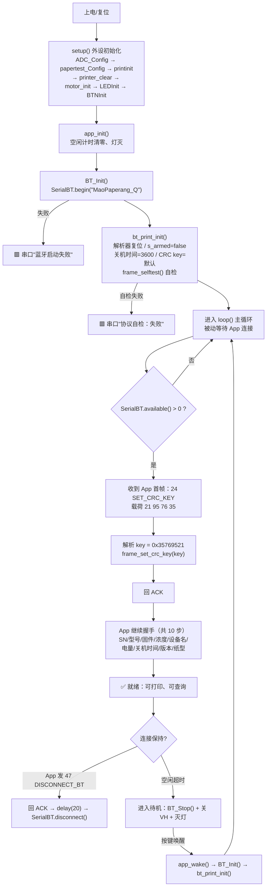

### 1.2 握手 10 步（时序表）

| 顺序 | App 发（type） | 载荷 | 设备回 | 回的内容 |
|---|---|---|---|---|
| 1 | 24 SET_CRC_KEY | `21 95 76 35` | ACK | — |
| 2 | 10 GET_SN | 空 | 11 SENT_SN | `"P1001705253855"` |
| 3 | 66 | 空 | 67 | `"BK3432"`（6 字节） |
| 4 | 127 | 空 | 128 | `"v3.38.19"`（12 字节，后 4 字节补 0） |
| 5 | 25 SET_HEAT_DENSITY | 1 字节（实测 95） | ACK | — |
| 6 | 48 GET_DEV_NAME | 空 | 49 | `"P1"`（2 字节） |
| 7 | 16 GET_BAT_STATUS | 空 | 17 | 电量 0~100 |
| 8 | 31 GET_POWER_DOWN_TIME | 空 | 32 | 3600（2 字节小端） |
| 9 | 4 GET_VERSION | 空 | 5 | `01 00 02`（= 2.0.1） |
| 10 | 44 SET_PAPER_TYPE | 1 字节 | ACK | — |

> **关键约束**：App 是"发一条 → 等应答 → 超时重发 → 三次失败断开"的同步状态机。
> **漏回任何一条，连接就卡死**。所以 `handle_frame()` 的 `default` 分支对未知指令一律回 ACK。

### 1.3 关键代码

```c
// bluetooth.cpp
void BT_Init(void){
    if(!SerialBT.begin(BT_NAME)){ Serial.println("蓝牙启动失败"); return; }
}
// bt_print.cpp:263
void bt_print_init(void){
    s_parser.reset();
    s_armed = false;
    app_set_power_down_min(3600);
    frame_set_crc_key(FRAME_CRC_KEY_DEFAULT);
    Serial.print("协议自检：");
    Serial.println(frame_selftest(s_parser, s_frame) ? "OK" : "失败");
}
```

### 1.4 异常分支

| 现象 | 原因 | 处理 |
|---|---|---|
| App 看不到设备 | 名字不匹配 | 必须叫 `MaoPaperang_Q`（或 `MaoPaperang`） |
| 连上就断/转圈 | 握手有一步没回 | 串口查是否每条指令都有回；确认 `default` 分支回 ACK |
| 自己断连 | App 发 47 | 正常，已实现真断开 |
| 连不上但串口正常 | 已被别的设备占用 | 经典 SPP **同一时间只能连一个主机** |

---

## §2 通信流程

### 2.1 帧格式（回顾）

```
┌──────┬──────┬──────┬───────┬───────┬─────────┬────────────┬──────┐
│ 0x02 │ type │ idx  │ lenL  │ lenH  │ payload │ CRC32 (LE) │ 0x03 │
└──────┴──────┴──────┴───────┴───────┴─────────┴────────────┴──────┘
  1B     1B     1B     1B      1B       len B        4B         1B
总长 = len + 10，单包 len ≤ 1920（打印数据 = 40 行）
```

### 2.2 流程图

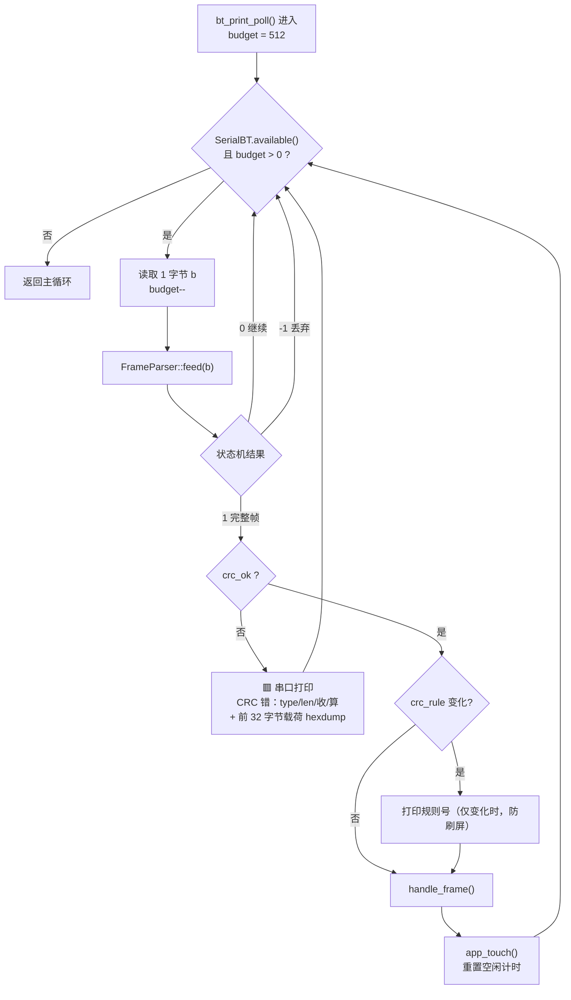

### 2.3 解析器状态机

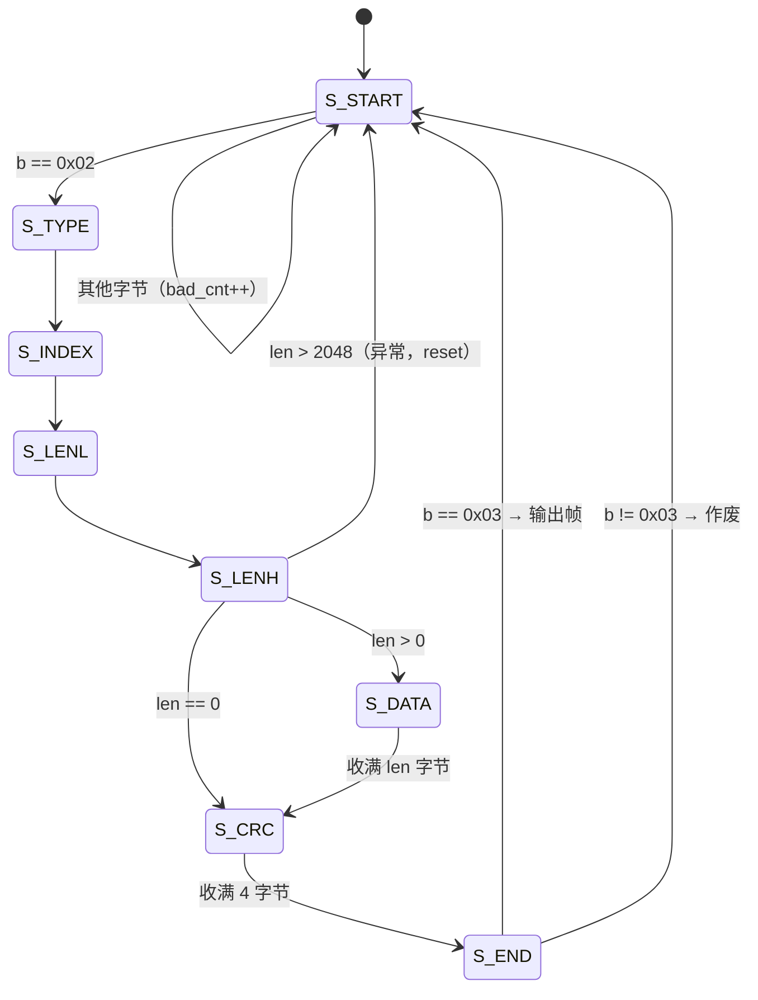

### 2.4 CRC 校验：五条候选规则

```
规则 0（主规则，App 实测）  crc32_seeded(key, payload, len)
规则 1（标准 zlib）         crc32_calc(payload, len)
规则 2（标准 zlib + 帧头）  crc32_calc(header + ack字节, len)
规则 3（key + 帧头）        crc32_seeded(key, header, len)
规则 4（帧内 key 自校验）   仅 SET_CRC_KEY：crc32_seeded(payload里的key, payload, 4)
规则 5（全 0）              len==0 且 crc==0（老工具）
```
> **命中哪条记在 `Frame::crc_rule`**，串口只在规则变化时提示一次。
> 规则 1 命中是**正常现象**（App 对非密钥帧用 Java 标准 CRC32）。

### 2.5 应答规则与发送

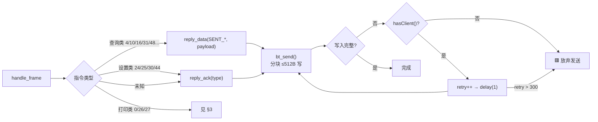

> **禁止用 `availableForWrite()`**：这版 `BluetoothSerial` 没实现，基类永远返回 0，会死循环。

### 2.6 异常处理原则

| 情况 | 做法 | 原因 |
|---|---|---|
| CRC 错 | **不回任何帧**，让 App 超时重发 | 协议无 NAK 帧 |
| 帧尾不是 0x03 | 整帧作废，回 S_START | 防连锁错位 |
| len > 2048 | 立即 reset | 防伪造长度撑爆缓冲 |
| 未知指令 | **回 ACK** | 保证握手不卡死 |
| 打印结束 | `print_drain()` 排空 + 解析器复位 | 防残留错帧（见 §3.4） |

---

## §3 下发打印流程

### 3.1 阶段一：App 侧时序

```
25 SET_HEAT_DENSITY    ← 设浓度（App 会连发 2 次，值是 95）
25 SET_HEAT_DENSITY
26 FEED_LINE           ← 第 1 次：开始一页（s_armed = true，job_begin）
0  PRINT_DATA          ← 第 1 包（≤1920 字节 = 40 行）
0  PRINT_DATA          ← 第 2 包
   ...
0  PRINT_DATA          ← 第 N 包
26 FEED_LINE           ← 第 2 次：触发打印（s_armed → false，job_print）
```

### 3.2 固件侧状态机（`s_armed`）

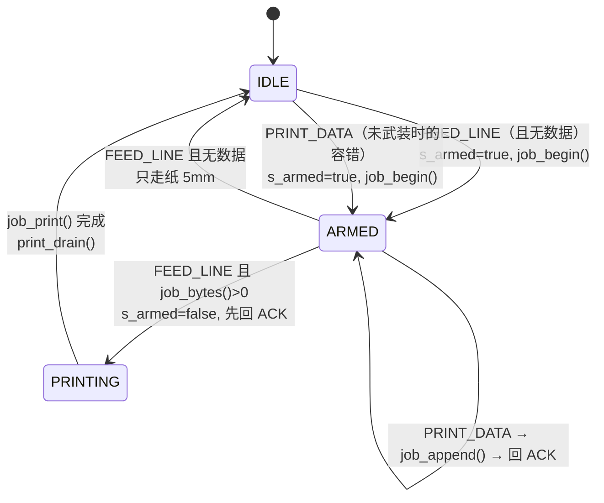

### 3.3 完整流程图

```mermaid
flowchart TD
    A["收到 FEED_LINE(26)"] --> B{"s_armed ?"}
    B -->|false| C["s_armed = true<br/>job_begin()<br/>回 ACK"]
    B -->|true| D{"job_bytes() > 0 ?"}
    D -->|否| E["s_armed=false<br/>job_feed_mm(5)<br/>回 ACK"]
    D -->|是| F["s_armed = false<br/>⏱ reply_ack() 先应答（防 6 秒超时）"]
    F --> G["app_set_busy(true) → LED 常亮"]
    G --> H["job_print()  ← 同步阻塞 6~25 秒"]
    H --> I["app_set_busy(false)"]
    I --> J["print_drain()<br/>读空队列 + 解析器复位"]
    J --> K[回到主循环]

    L["收到 PRINT_DATA(0)"] --> M{"s_armed ?"}
    M -->|false| N["s_armed=true<br/>job_begin()"]
    M -->|true| O
    N --> O{"job_append(p, n)"}
    O -->|成功| P["回 ACK"]
    O -->|失败(溢出/内存不足)| Q["🟥 s_valid=false<br/>串口&quot;页缓冲不足，丢弃本包&quot;<br/>仍回 ACK"]
```

### 3.4 为什么打印后必须排空（关键设计）

```
打印期间（6~25 秒阻塞）
  ├─ App 可能已发来下一单的数据
  └─ 这些字节堆在 20480 字节队列里
              ↓
     打印结束直接继续解析
              ↓
  🟥 上一单的 PRINT_DATA / FEED_LINE 被当成新指令 → 又打一张 / 打乱码
              ↓
         print_drain()
  ├─ while(SerialBT.available()) read();   // 读空
  └─ s_parser.reset();                     // 回到 S_START
```

### 3.5 `job_print()` 内部流程

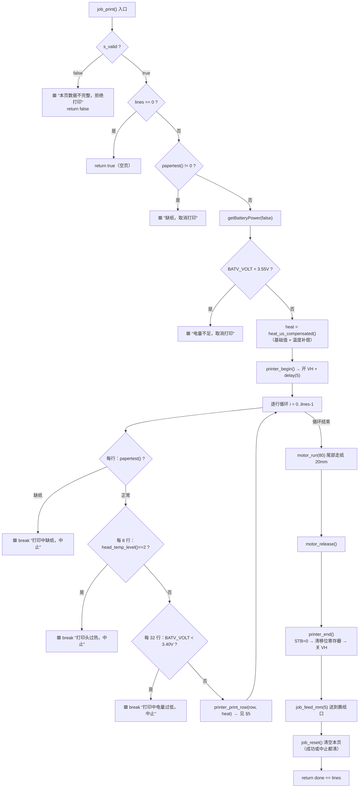

### 3.6 页缓冲管理

| 阶段 | 函数 | 行为 |
|---|---|---|
| 开始一页 | `job_begin()` | `s_len=0, s_valid=true`，确保至少 32 行容量 |
| 追加数据 | `job_append()` | 容量不足 → 按 8KB 翻倍 `realloc`；超 64KB → `s_valid=false` |
| 查询 | `job_bytes()` / `job_lines()` | 行数 = 字节数 / 48 |
| 打印完 | `job_reset()` | 清长度、恢复有效标志（**不释放内存**，留给下一页） |

> **64KB 上限 ≈ 1365 行 ≈ 170mm**，超过就整页作废，不"假装成功"。

---

## §4 电机驱动流程

### 4.1 硬件与相位

| 项 | 值 |
|---|---|
| 类型 | 两相四线双极步进 |
| 驱动 | TC1508S 双 H 桥，4 路 GPIO 直驱 |
| 引脚 | AP=22 / AM=23 / BP=19 / BM=21 |
| 步距角 | 9°（整步 0.0625mm） |
| 半步 | 0.03125mm，**32 半步/mm** |
| 一行 | 0.125mm = **4 个半步** |

### 4.2 八拍相位表

```
拍  A+ A- B+ B-
0   1  0  0  0     A+
1   1  0  1  0     A+ B+   ← 半步
2   0  0  1  0     B+
3   0  1  1  0     A- B+   ← 半步
4   0  1  0  0     A-
5   0  1  0  1     A- B-   ← 半步
6   0  0  0  1     B-
7   1  0  0  1     A+ B-   ← 半步
```

### 4.3 流程图

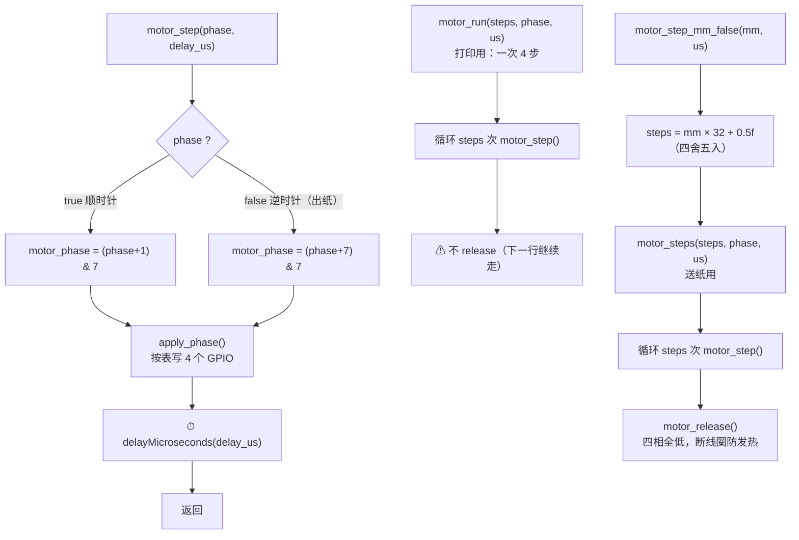

### 4.4 两套步进速度（重要）

| 场景 | 调用 | 每半步 | 等效频率 | 为什么不同 |
|---|---|---|---|---|
| **打印中走纸** | `motor_run(4, false, 2000)` | 2000µs | 500 半步/s | 要克服打印头压紧力 + 加热时电池压降 → 保力矩不丢步 |
| **手动/尾部送纸** | `motor_step_mm_false(10, 1000)` | 1000µs | 1000 半步/s | 无压紧力、空走，可提速 |

> 500 半步/s 对应规格书表 11 的 **3.5V / 500PPS** 那一行，是全电压范围都安全的保守值。

### 4.5 方向与释放

- **出纸 = 逆时针**（`phase=false`，相位 +7）。搞反会导致纸往回退、重叠加黑。
- **释放时机**：`motor_steps()` / `motor_step_mm_*()` 末尾统一 `motor_release()`；
  `motor_run()` 故意不释放（一行内的 4 步要连续），整页结束由 `job_print()` 统一释放。

---

## §5 打印头打印流程

### 5.1 一行的完整时序（本项目核心）

```
① motor_run(4, false, 2000)     走 0.125mm                    ⏱ 8.0 ms
② delay(2)                       让出 CPU / 喂 task WDT        ⏱ 2.0 ms
③ printhead_send(row)
     ├─ SPI.beginTransaction(1MHz, MODE0, MSB)
     ├─ SPI.writeBytes(row, 48)  384 bit 移位                   ⏱ 0.384 ms
     ├─ LAT 拉高 → delayMicroseconds(1) → LAT 拉低（idle 低）
     └─ endTransaction
④ delayMicroseconds(1000)        数据建立 / 等 VH 恢复          ⏱ 1.0 ms
⑤ for i in 0..5:                 6 段依次加热
     ├─ STB_i = 1
     ├─ delayMicroseconds(heat)   基础 1500+density×20，含温度补偿 ⏱ 3.4 ms
     ├─ STB_i = 0
     └─ delayMicroseconds(300)    段间冷却（给 47µF 回充）        ⏱ 0.3 ms
                                                   小计 6 × 3.7 = 22.2 ms
────────────────────────────────────────────────────────────
每行合计 ≈ 33.6 ms  →  等效 3.7 mm/s
```

### 5.2 流程图

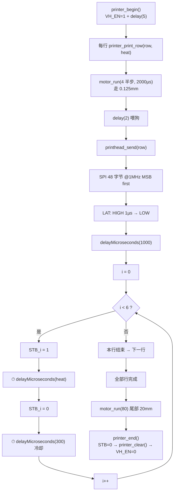

### 5.3 加热时间怎么算

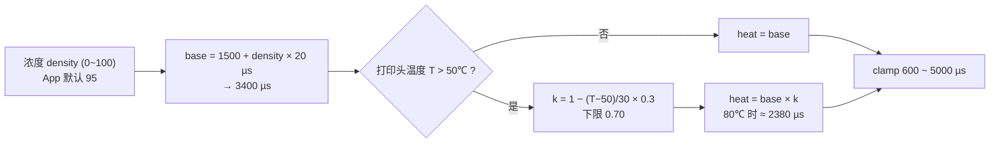

| 温度 | 系数 k | density=95 时加热 |
|---|---|---|
| ≤50℃ | 1.00 | 3400 µs |
| 60℃ | 0.90 | 3060 µs |
| 70℃ | 0.80 | 2720 µs |
| ≥80℃ | 0.70 | 2380 µs（且会中止打印） |

### 5.4 关键代码

```c
void printer_print_row(const uint8_t row[HEAD_BYTES], uint32_t heat_time_us){
  motor_run(4, false, 2000);          // ① 走 0.125mm
  delay(2);                           // ② 喂狗
  printhead_send(row);                // ③ SPI + LAT 锁存
  delayMicroseconds(1000);            // ④ 数据建立
  for (uint8_t i = 0; i < 6; i++) {   // ⑤ 6 段加热
    printhead_stb(1 << i);
    delayMicroseconds(heat_time_us);
    printhead_stb(0);
    delayMicroseconds(300);           //    段间冷却
  }
}
```

### 5.5 异常与限制

| 项 | 值/约束 | 说明 |
|---|---|---|
| LAT 极性 | **idle 低 / 脉冲高** | 教程说反了；LAT 同时门控加热通路 |
| 上电顺序 | STB=0 → 清移位寄存器 → 开 VH | 否则随机数据会烧发热点 |
| 单点占空比 | 3.4 / 33.6 ≈ **10.1%** ≤ 12.5% | 超了会积热烧头 |
| 段间冷却 | 300µs | 20µs 会"打几毫米后变白"，500µs 正常 |
| 一段电流 | 2.75A @8.4V | 6 段同时 16.5A，所以必须分段 |

---

## §6 缺纸检测流程

### 6.1 电路与逻辑

```
打印头内反射式光电(PHK/PHE/VSE)
        │ 有纸→反射→输出低；缺纸→无反射→输出高
        ▼
   LM393 比较器（开漏输出）
        │ 阈值由 R31/R32/R34/R35 分压设定
        ▼
   R30 10k 上拉 → PHINT(GPIO35)
        │
     HIGH = 缺纸   LOW = 有纸
```

> GPIO35 是**纯输入脚，无内部上拉**，所以板上必须有 R30，否则永远读不到高电平。

### 6.2 流程图

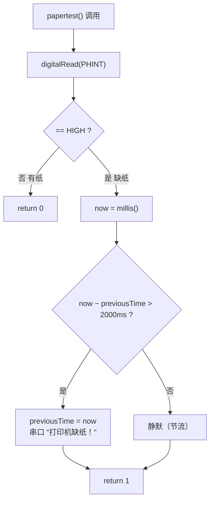

### 6.3 调用点（三个位置）

| 调用点 | 频率 | 动作 |
|---|---|---|
| `loop()` 主循环 | 每圈（内部 2 秒节流） | 传给 `app_loop()` → LED 快闪 |
| `job_print()` 打印前 | 每页一次 | 缺纸 → **拒绝打印** |
| `job_print()` 打印中 | **每行一次** | 缺纸 → **立即 break 中止** |

### 6.4 为什么"每行都要查"

> 缺纸时加热没有纸吸收热量，热量全部积在发热点上 → **几秒内烧毁打印头**。
> 规格书明确要求"缺纸时不得加热"，所以打印中必须逐行确认，不能只查一次。

### 6.5 代码

```c
uint8_t papertest(void){
    unsigned long now = millis();
    static unsigned long previousTime = 0;
    if (digitalRead(PHINT) == HIGH) {
        if ((now - previousTime) > 2000) { previousTime = now; Serial.print("打印机缺纸！\r\n"); }
        return 1;
    }
    return 0;
}
```
> 用 `(now - previous)` 而不是 `now > previous + 2000`，是为了让 `millis()` 49.7 天溢出回绕时依然正确。

---

## §7 电量检测流程

### 7.1 电路

```
18650 (+) ── R27 10k ──┬── R29 10k ── GND
                       │
                  C35 100nF
                       │
                  POWER_ADC (GPIO34)
分压比 1:1 → Vadc = VBAT / 2 → VBAT = Vadc × 2
```

### 7.2 流程图

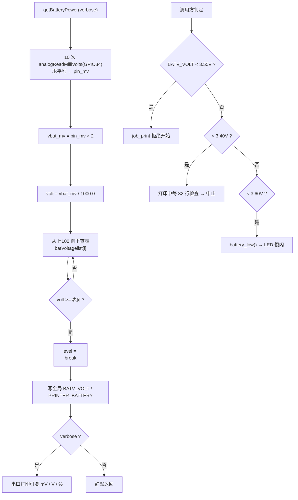

### 7.3 三级阈值

| 宏 | 值 | 触发点 | 动作 |
|---|---|---|---|
| `BAT_LOW_V` | 3.60V | `battery_low()` → `app_loop` | LED **1 秒慢闪**，仍可打印 |
| `BAT_STOP_V` | 3.55V | `job_print()` 开始前 | **拒绝**开始新打印 |
| `BAT_ABORT_V` | 3.40V | 打印中每 32 行 | **立即中止**，保住已打部分 |

### 7.4 为什么必须查表（101 点）

锂电池放电曲线高度非线性，固件里的 `batVoltagelist[101]` 实际映射如下（截取关键点）：

| 电压 | 表内电量 | 相邻档电压差 |
|---|---|---|
| 4.20 V | 100% | — |
| 4.06 V | 90% | 0.14 V / 10% |
| 3.98 V | 80% | 0.08 V / 10% |
| 3.90 V | 60% | 0.08 V / 20% |
| 3.87 V | 50% | 0.03 V / 10% ← **最平坦段** |
| 3.84 V | 40% | 0.03 V / 10% |
| 3.81 V | 30% | 0.03 V / 10% |
| 3.78 V | 20% | 0.03 V / 10% |
| 3.73 V | 10% | 0.05 V / 10% |
| 3.68 V | 3% | 0.05 V / 7% |
| 3.60 V | 1% | — |
| 3.40 V | 0% | 0.20 V / 1% |

**平坦段就是"虚电区"**：3.78~3.87V 这 0.09V 里藏着 30% 的容量，
所以这里每 10% 只差 **30 mV** —— ADC 误差 15mV 就是 5% 电量，读数看起来"跳"。

**线性换算会错多少**：
```
线性公式：(V − 3.40) / 0.80 × 100%
3.80V → 线性 50%，查表 22%   → 差 28 个百分点
3.75V → 线性 44%，查表 15%   → 差 29 个百分点
```
> 这张表整体偏**保守**（低电量段读数低于常见曲线），好处是不会"显示 20% 却打不动"。

### 7.5 采样时机（避免瞬态误判）

| 时机 | 说明 |
|---|---|
| 主循环每 500ms | 常规刷新，供 LED 和 `GET_STATUS` 用 |
| `job_print()` 开始前 | **加热尚未开始**，电压真实 |
| 打印中每 32 行 | 取"行间隙"，避开加热瞬间的 0.3~0.5V 压降 |
| `GET_BAT_STATUS` / `GET_VOLTAGE` 收到时 | **先刷新再回**，不用旧值 |

---

## §8 打印头温度流程

### 8.1 电路与参数

```
3V3 ── R22 10k ──┬── THER (GPIO36)
                 │
              NTC 30kΩ@25℃, B=3950K
                 │
                GND

温度↑ → NTC 阻值↓ → 引脚电压↓
25℃ 时引脚电压 = 30k/(30k+10k) × 3300 ≈ 2475 mV   ← 标定点
```

### 8.2 流程图

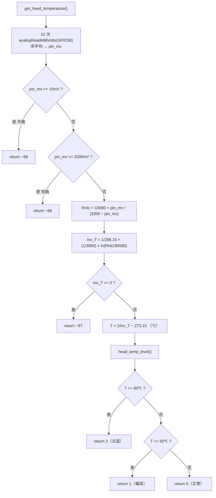

### 8.3 分级后的动作

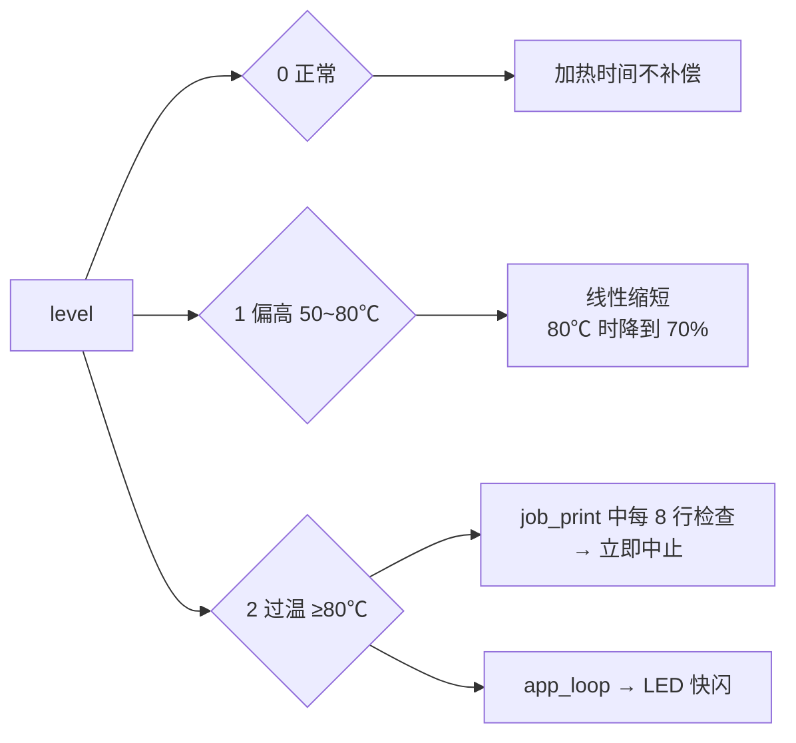

### 8.4 公式与参数

```
① 反推阻值   Rntc = R_pullup × Vadc / (Vcc − Vadc)      (R_pullup=10k, Vcc=3300mV)
② B 值公式   1/T = 1/T25 + (1/B)·ln(Rntc/R25)           (T25=298.15K, B=3950, R25=30k)
③ 转摄氏度   ℃ = 1/(1/T) − 273.15
```

| 温度 | NTC 阻值 | 引脚电压 | 加热系数 |
|---|---|---|---|
| 25℃ | 30.0 kΩ | 2475 mV | 1.00 |
| 40℃ | 15.9 kΩ | 2026 mV | 1.00 |
| 50℃ | 10.8 kΩ | 1710 mV | 1.00 |
| 60℃ | 7.5 kΩ | 1410 mV | 0.90 |
| 70℃ | 5.3 kΩ | 1140 mV | 0.80 |
| 80℃ | 3.8 kΩ | 910 mV | 0.70（中止） |

> 阻值按 `R = 30k × exp(3950 × (1/T − 1/298.15))` 计算，电压按 10k 上拉分压得出。
> **注意 25℃ 的 2475 mV 是最好的现场校表点**：实测对不上，说明 R25 或上拉电阻选错了。

### 8.5 采样频率与已知缺陷

| 位置 | 频率 | 原因 |
|---|---|---|
| `loop()` 每 500ms | 慢 | ADC 采 10 次约 0.5ms，每圈做浪费 |
| `job_print()` 每 8 行 | ≈270ms 一次 | 热是慢变量，8 行足够 |
| `GET_TEMP` / `GET_STATUS` | 收到即采 | 查询要最新值 |

> ⚠️ **已知缺陷**：NTC **断线返回 −99**，而 `head_temp_level()` 把负值判为 0（正常），
> 也就是断线时**不会触发过温保护**。正确做法应把异常值当作"限制功率/禁止打印"。
> 修复位置：`adc.cpp` 的 `head_temp_level()` 加一条 `if (t < 0) return 2;`（或单独的错误码）。

---

## §9 状态机与主循环时序汇总

### 9.1 主循环

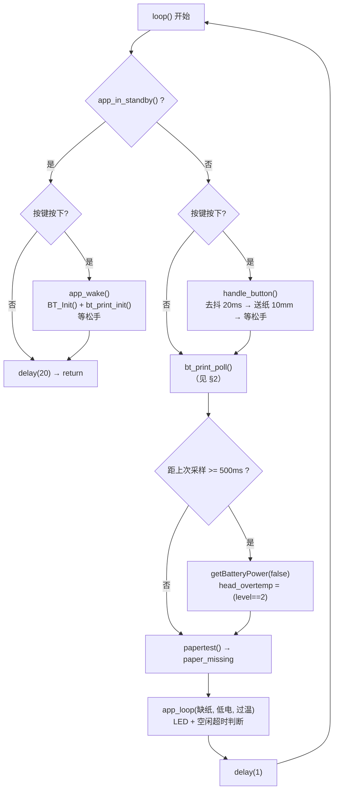

### 9.2 LED 状态表

| 状态 | 表现 | 代码 |
|---|---|---|
| 打印中 | **常亮** | `app_set_busy(true)` |
| 缺纸 / 过温 | **200ms 快闪** | `app_loop` 传参 |
| 低电（<3.60V） | **1s 慢闪** | `app_loop` 传参 |
| 正常 / 待机 | 熄灭 | — |

### 9.3 自动待机

| 项 | 值 |
|---|---|
| 默认超时 | 60 分钟（`app_init`） |
| App 可设 | `SET_POWER_DOWN_TIME`（实测 App 发 3600 分钟） |
| 触发条件 | 空闲超时 **且** 不在打印（`!s_busy`） |
| 进入动作 | `BT_Stop()` + 关 VH + 灭灯 |
| 唤醒 | 按键（GPIO5）→ `app_wake()` + `BT_Init()` + `bt_print_init()` |
| 为什么不用 deep sleep | GPIO5 不是 RTC 唤醒脚，进了深睡只能手动复位 |

### 9.4 各流程的时间预算

| 流程 | 耗时 | 说明 |
|---|---|---|
| 连接 + 握手 | ~50 ms | 10 条指令往返 |
| 接收一页数据 | 0.2~0.4 s | 20KB @ SPP ~100KB/s |
| 打印一页（100mm） | **≈27 s** | 800 行 × 33.6ms |
| 单行 | 33.6 ms | 加热占 66% |
| 缺纸检测 | <1 µs | 一次 `digitalRead` |
| 电量采样 | ~0.5 ms | 10 次 ADC |
| 温度采样 | ~0.5 ms | 10 次 ADC + log |

---

> **本文档与其它文档的关系**：
> - `笔记.md`：原始学习笔记（知识点备忘）
> - `项目总结.md`：设计取舍、数据、踩坑与计划
> - `面试问题合集.md`：133 题问答（本文档的"为什么"层）
> - **本文档**：8 个流程的"怎么做"层，与代码一一对应
